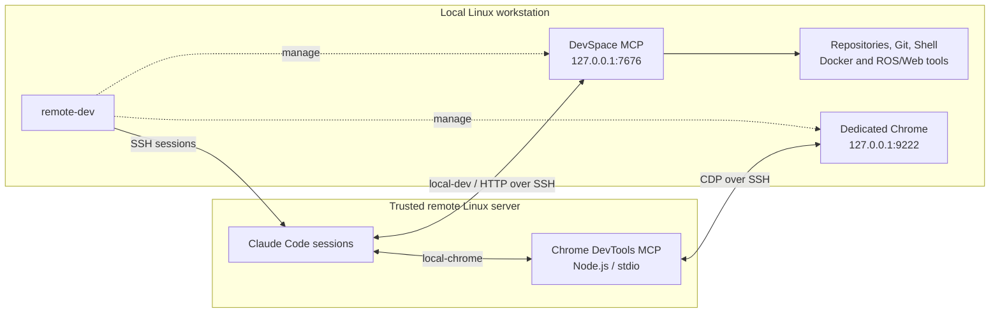

# remote-dev

Run Claude Code on a trusted remote Linux server while keeping files, builds and web applications on your local workstation. One SSH connection supports multiple Claude sessions and repositories. Codex support is planned.

## Architecture



DevSpace handles local files and commands. Chrome DevTools MCP runs remotely and controls local Chrome. Projects keep their existing directories and build environments; source files are not synchronized.

| SSH forward | Direction | Port |
| --- | --- | --- |
| DevSpace MCP | Remote loopback → local DevSpace | `7676` |
| Browser CDP, with `--browser` | Remote loopback → local Chrome | `9222` |
| OAuth callback | Local browser → remote client callback | `8765` |

## Requirements

| | Local workstation | Remote server |
| --- | --- | --- |
| Environment | Linux, Python 3.8+, OpenSSH client, systemd user manager | Linux, Python 3.8+, SSH server with forwarding enabled |
| Node.js | Node 24 and npm, for DevSpace | Compatible Node and npm, only for browser mode |
| Claude Code | Not required | Installed and authenticated |
| Chrome | `google-chrome` and a desktop display, only for browser mode | Not required |

`--with-node` permits a private Node 24.22.2 download for Linux x64/arm64 when no compatible runtime exists. The archive is checked against official SHA256 checksums. Existing compatible Node is reused; other prerequisites remain user-managed. No sudo or shell/account changes are required.

The pinned browser MCP supports Node `^20.19.0 || ^22.12.0 || >=23`. Remote installation reuses a compatible runtime.

## Installation and use

Clone or download the repository, keep its directory, and run:

```bash
./remote-dev install --host USER@HOST -i /path/to/private-key --browser
```

The command prepares local dependencies, creates the PATH symlink and DevSpace service, and configures the specified remote server. It does not start services or enable automatic startup. Ensure `~/.local/bin` is on PATH. Add `--with-node` if needed. Without `--host`, install prepares only the local side; without `--browser`, it skips browser support.

Then use local terminals:

```bash
remote-dev start --host USER@HOST -i /path/to/private-key --browser
remote-dev open
remote-dev open /path/to/api /another/path/to/ui
remote-dev status
remote-dev status --json
remote-dev stop
```

`start` enables shared access and returns. Each `open` launches an independent Claude session for the current directory or supplied paths. Multiple sessions can share a project; only one remote target can be active at a time.

| Command / option | Purpose |
| --- | --- |
| `install` | Prepare dependencies, services and MCP configuration |
| `start --host USER@HOST` | Start shared access; `--browser` enables local Chrome |
| `open [PATH ...]` | Open a Claude session |
| `status [--json]` | Inspect access, browser and sessions |
| `stop` | Close managed sessions and access |
| `uninstall [--host USER@HOST]` | Remove owned local and optional remote installation resources |
| `-i`, `--identity-file` | Local SSH private key, for install/start/uninstall |
| `--ssh-port PORT` | SSH port for install/start/uninstall; default `22` |
| `--with-node` | Permit private Node installation when needed |

Every new `start` needs an explicit target. No default host or identity is saved. `-i` is optional when SSH already has a usable identity or agent. Repeating `start` with identical options reuses access; changing options requires `stop`. Neither `start` nor `open` installs or updates dependencies.

An optional SSH alias shortens the command:

```sshconfig
Host dev-server
    HostName your-server-address
    User your-user
    IdentityFile ~/.ssh/your-key
    IdentitiesOnly yes
```

```bash
remote-dev start --host dev-server --browser
```

Pass `--ssh-port` for a non-default port.

## MCP and authentication

Native Claude tools run remotely. Use **local-dev** for local files, Git, Shell and project build commands; use **local-chrome** for the local browser.

For the first local-dev login, open `/mcp` in remote Claude. Open its authorization URL locally and enter the `ownerToken` from `~/.config/remote-dev/devspace/auth.json`. Keep this value private. Callback port `8765` is forwarded; authorize initial sessions one at a time. Browser MCP needs no separate AI-account login.

Alternatively, run on the remote server:

```bash
claude mcp login --no-browser local-dev
```

To allow a development disk outside the default local home root, stop access and edit `workspaces.allowedRoots` in `~/.config/remote-dev/devspace/config.jsonc`. Use strict JSON without comments or trailing commas.

## Lifecycle and permissions

Exiting one Claude session leaves other sessions and shared access running. Even with no sessions, access stays enabled until stop. Stop closes managed SSH channels, DevSpace and Chrome created by this connection; borrowed/replaced browsers and profile data are preserved. A watcher cleans up owned access after detecting SSH or DevSpace failure. There is no automatic startup or reconnection.

Stop does not undo edits or stop independent project containers. The tool does not launch ROS, replay data or start business services. Parallel sessions share files and browser pages: coordinate edits and shared builds, or use Git worktrees for separate branches.

Use trusted remote accounts. Workspace roots select projects; they do not sandbox Shell commands, which retain your local user's file, network and Docker permissions. SSH agent forwarding is disabled, and private-key contents stay local.

Keep SSH-server `GatewayPorts no` so reverse forwards stay on loopback. CDP has no separate authentication; remote processes able to reach its forwarded port can control the browser. A dedicated Chrome profile separates development state, not OS permissions.

## Maintenance

Installation is repeatable while access is stopped. It preserves authentication/configuration and refuses unrelated command entries, services and MCP registrations. Both npm runtimes use repository lockfiles and staged `npm ci` installation. If remote preparation fails, completed local install remains usable; fix the error and rerun install.

To update, stop access, update this checkout and rerun install. Tracked runtime trees are removed by uninstall when no preserved MCP registration needs them; untracked legacy directories are left alone. Back up application data before downgrading because database migrations may limit compatibility.

```bash
remote-dev uninstall --host USER@HOST -i /path/to/private-key
```

Without `--host`, uninstall is local-only. It removes recorded unchanged owned resources, preserving modified MCP registrations and runtimes they may use. Credentials, configuration, browser profile, Claude history, workspaces and project workloads remain. A local ownership record allows reinstalling with `./remote-dev install`.

## Files

```text
remote-dev                 CLI, SSH and session management
lib/browser.py             dedicated Chrome lifecycle
lib/install.py             dependencies, services and MCP configuration
lib/common.py              state, process identity and SSH helpers
runtimes/*/                npm manifests and lockfiles
tests/                     isolated regression tests
```

| Path | Contents |
| --- | --- |
| `~/.local/bin/remote-dev` | Symlink to this checkout |
| `~/.config/remote-dev/devspace/` | Local configuration and owner authentication |
| `~/.local/share/remote-dev/` | Managed runtimes and installation records; local DevSpace state |
| `$XDG_RUNTIME_DIR/remote-dev/` | Local connection/session records and SSH socket |
| `~/.local/state/remote-dev/browser/` | Browser record and logs |
| `~/.local/share/chrome-agent-dev/` | Local persistent Chrome profile |

Remote contexts live in `~/.local/share/remote-dev/workspaces/<project>-<hash>` or `multi-repo-<hash>` and contain generated instructions. Remote browser dependencies live under `~/.local/share/remote-dev/runtimes/chrome-devtools/`.

## Codex compatibility

The transport architecture is reusable: Codex supports [stdio and Streamable HTTP MCP with OAuth](https://developers.openai.com/codex/mcp). The current launcher is **Claude-only**; `--client codex` is not supported.

Codex needs client-specific install and launch handling, MCP registration in its own configuration, [AGENTS.md instructions](https://developers.openai.com/codex/guides/agents-md), and OAuth callback handling. Its MCP authorization is separate from Claude's. File operations, screenshots, approvals and concurrent sessions still need Codex end-to-end tests. The SSH/DevSpace/CDP topology does not need to change.

## Checks

```bash
remote-dev status --json
journalctl --user -u remote-dev.service -u remote-dev-link.service -n 30 --no-pager
PYTHONDONTWRITEBYTECODE=1 python3 -m unittest discover -s tests -v
```

Status exits `0` when shared access is running, `1` when stopped/partial and `2` on errors. Browser/session states are reported separately; health checks do not establish OAuth authorization.

Run stop to clear a confirmed abandoned Unix control socket. Active untracked sockets and unexpected files are preserved and reported.

GitHub Actions checks Python 3.8/3.12, CLI help and locked Node 24 dependency installation on pushes and pull requests. It uses no personal credentials or live servers/browsers; end-to-end workflows are tested separately.

## TODO

- [ ] Multiple remote targets concurrently.
- [ ] Selection-based paste.
- [ ] Direct local clipboard image paste.
- [ ] Remote Codex client adapter and acceptance tests.

## License and acknowledgments

remote-dev is licensed under the [MIT License](LICENSE).

Local development access is provided by [DevSpace](https://github.com/Waishnav/devspace) ([MIT](https://github.com/Waishnav/devspace/blob/main/LICENSE)). Browser debugging is provided by [Chrome DevTools MCP](https://github.com/ChromeDevTools/chrome-devtools-mcp) ([Apache-2.0](https://github.com/ChromeDevTools/chrome-devtools-mcp/blob/main/LICENSE)). Third-party dependencies retain their respective licenses.
