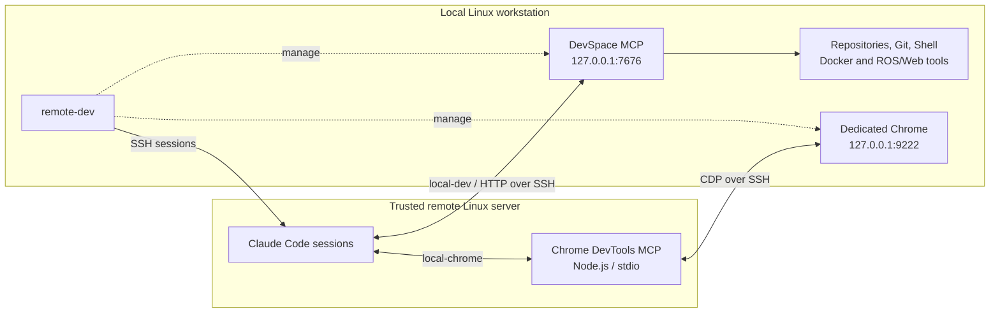

# remote-dev

Run Claude Code on a trusted remote Linux server while keeping files, builds and web applications on your local workstation. Several remote servers can be connected at once; each SSH connection supports multiple Claude sessions and repositories. Codex support is planned.

## Architecture



DevSpace handles local files and commands. Chrome DevTools MCP runs remotely and controls local Chrome. Projects keep their existing directories and build environments; source files are not synchronized.

| SSH forward | Direction | Port |
| --- | --- | --- |
| DevSpace MCP | Remote loopback → local DevSpace | `7676` |
| Browser CDP, with `--browser` | Remote loopback → local Chrome | `9222` |
| OAuth callback, one connection at a time | Local browser → remote client callback | `8765` |
| Clipboard images | Remote loopback → local clipboard socket | `7677` |

Image paste: `Ctrl+V` in remote Claude runs a remote `xclip` shim that reads images (never text) from the local X11 clipboard through `7677`, authenticated by a per-connection token. Copying text out needs no forward: remote Claude always uses OSC 52 over SSH, which the local terminal writes to the clipboard. In Claude's fullscreen renderer (`/tui fullscreen`) selecting text copies it; hold Shift for the terminal's native selection.

## Requirements

| | Local workstation | Remote server |
| --- | --- | --- |
| Environment | Linux, Python 3.8+, OpenSSH client, systemd user manager | Linux, Python 3.8+, SSH server with forwarding enabled |
| Node.js | Node 24 and npm, for DevSpace | Compatible Node and npm, only for browser mode |
| Claude Code | Not required | Installed and authenticated |
| Chrome | `google-chrome` and a desktop display, only for browser mode | Not required |
| Terminal | OSC 52 clipboard support to copy Claude output, such as WezTerm or kitty; VTE terminals (GNOME Terminal, Terminator) ignore it | Not required |
| Clipboard | X11 and `xclip` (`sudo apt install xclip`), only for image paste | Not required |

`--with-node` permits a private Node 24.22.2 download for Linux x64/arm64 when no compatible runtime exists. The archive is checked against official SHA256 checksums. Existing compatible Node is reused; other prerequisites remain user-managed. No sudo or shell/account changes are required.

The pinned browser MCP supports Node `^20.19.0 || ^22.12.0 || >=23`. Remote installation reuses a compatible runtime.

## Installation and use

Clone or download the repository, keep its directory, and run:

```bash
./remote-dev install --host USER@HOST -i /path/to/private-key --browser
```

The command prepares local dependencies, creates the PATH symlink and DevSpace service, and configures the specified remote server. It does not start services or enable automatic startup. Ensure `~/.local/bin` is on PATH. Add `--with-node` if needed. Without `--host`, install prepares only the local side; without `--browser`, it skips browser support. A successful install remembers the target, port and key path, so later commands need none of them.

Then use local terminals:

```bash
remote-dev start --browser
remote-dev open
remote-dev open /path/to/api /another/path/to/ui
remote-dev status
remote-dev status --json
remote-dev stop
```

`start` enables shared access and returns. Each `open` launches an independent Claude session for the current directory or supplied paths. Multiple sessions can share a project.

| Command / option | Purpose |
| --- | --- |
| `install [-H TARGET] [--name NAME]` | Prepare dependencies, services and MCP configuration; remembers the target |
| `start [-H TARGET] [--name NAME]` | Start shared access to a server; `--browser` enables local Chrome |
| `open [-H TARGET] [PATH ...]` | Open a Claude session |
| `status [-H TARGET] [--json]` | Inspect access, browser and sessions of all or one connection |
| `stop [-H TARGET \| --all]` | Close a connection with its sessions, or all of them |
| `auth [-H TARGET]` | Move the local OAuth callback port `8765` to a connection |
| `uninstall [-H TARGET]` | Remove owned local and optional remote installation resources; forgets the target |
| `-i`, `--identity-file` | Local SSH private key, for install/start/uninstall |
| `--ssh-port PORT` | SSH port for install/start/uninstall; default `22` or the remembered port |
| `--with-node` | Permit private Node installation when needed |

`-i` is optional when SSH already has a usable identity or agent. Repeating `start` for a running target reuses access. Adding `--browser` enables Chrome and its SSH forward without interrupting existing sessions. Repeat it to reopen Chrome after closing it. `--name` renames it in place. Other option changes for a running target require stopping it. Neither `start` nor `open` installs or updates dependencies.

### Multiple servers and target selection

Prepare each server once, then run `start` once per server. Connections are independent and share the local DevSpace and Chrome. While access is running, `install --host` prepares only the new server and leaves the local installation untouched.

```bash
remote-dev install -H ubuntu@13.229.1.2 -i ~/.ssh/aws.pem --name aws-sg --browser   # the only full entry
remote-dev start -H aws --browser
remote-dev install -H me@172.25.2.23 --ssh-port 2222 --name nexcom23
remote-dev start -H nex
remote-dev open -H aws                 # several connections: choose one
export REMOTE_DEV_HOST=nex             # or fix this terminal to one server
remote-dev open
remote-dev auth -H nex                 # before the first local-dev login on that server
remote-dev stop -H aws                 # nexcom23 keeps running; stop --all closes both
remote-dev start -H aws                # later: the remembered port and key are reused
```

Every successful `install --host` and `start` remembers its target, port, identity-file path (never key contents) and optional `--name` in `~/.config/remote-dev/targets.json`; `uninstall --host` forgets it. `install`, `uninstall` and `start` resolve `-H` the same way.

`TARGET` is an exact name or `[USER@]HOST`, or a prefix of a name or of the hostname part, e.g. `nex` for the name `nexcom23` or for `user@nexcom23`; `user@nex` matches hostnames of that user only. Names are optional short labels, useful for IP addresses; `--name` on `install` or `start` sets or renames one. A prefix ending in a digit does not match further digits, so `server1` never selects `server10` and `10.0.0.1` never selects `10.0.0.12`. Append `:PORT` to choose between connections to one host. Prefix `=` to disable matching, e.g. `start -H =prod` for an SSH alias `prod` while `deploy@prod-db` is remembered. A prefix must match exactly one candidate, otherwise the command lists the candidates.

| Command | Without `-H` | With `-H TARGET` |
| --- | --- | --- |
| `start` | The running connection if there is exactly one; the last target if none is running; an error if several are running | Remembered or running targets; an unmatched value is used as a new SSH target, so SSH aliases work |
| `open`, `stop`, `auth` | `REMOTE_DEV_HOST`, else the only running connection; an error if several are running | Running connections only |
| `status` | All connections | One connection |

Each command prints the resolved target. `REMOTE_DEV_HOST` is never ignored: if it names no running connection, the command fails. Explicit `--ssh-port` and `-i` override remembered values.

Limitations: all servers control the same Chrome pages. A machine can be connected only once: reaching the same server under two names or two users fails because its loopback ports `7676`/`7677` are already forwarded.

Browser support must already be prepared with `install --host USER@HOST --browser`. Closing Chrome leaves SSH, DevSpace and Claude running, but browser tools become unavailable. After enabling or reopening it, reconnect `local-chrome` through Claude's `/mcp` if needed and tell existing sessions that browser access is enabled.

An optional SSH alias shortens the command:

```sshconfig
Host dev-server
    HostName your-server-address
    User your-user
    IdentityFile ~/.ssh/your-key
    IdentitiesOnly yes
```

```bash
remote-dev start --host dev-server --browser
```

Pass `--ssh-port` for a non-default port.

## MCP and authentication

Native Claude tools run remotely. Use **local-dev** for local files, Git, Shell and project build commands; use **local-chrome** for the local browser.

For the first local-dev login, open `/mcp` in remote Claude. Open its authorization URL locally and enter the `ownerToken` from `~/.config/remote-dev/devspace/auth.json`. Keep this value private. Callback port `8765` is forwarded to the first connection; with several servers, run `remote-dev auth -H TARGET` before logging in on another one. Authorize initial sessions one at a time. Browser MCP needs no separate AI-account login.

Alternatively, run on the remote server:

```bash
claude mcp login --no-browser local-dev
```

To allow a development disk outside the default local home root, stop access and edit `workspaces.allowedRoots` in `~/.config/remote-dev/devspace/config.jsonc`. Use strict JSON without comments or trailing commas.

## Lifecycle and permissions

Exiting one Claude session leaves other sessions and shared access running. Even with no sessions, access stays enabled until stop. Stop closes a connection's SSH channels and sessions; DevSpace and Chrome started by remote-dev stop with the last connection that uses them, while borrowed/replaced browsers and profile data are preserved. Each connection's watcher cleans it up after detecting SSH or DevSpace failure. There is no automatic startup or reconnection.

Stop does not undo edits or stop independent project containers. The tool does not launch ROS, replay data or start business services. Parallel sessions share files and browser pages: coordinate edits and shared builds, or use Git worktrees for separate branches.

Use trusted remote accounts. Workspace roots select projects; they do not sandbox Shell commands, which retain your local user's file, network and Docker permissions. SSH agent forwarding is disabled, and private-key contents stay local.

Keep SSH-server `GatewayPorts no` so reverse forwards stay on loopback. CDP has no separate authentication; remote processes able to reach its forwarded port can control the browser. A dedicated Chrome profile separates development state, not OS permissions.

## Maintenance

Installation is repeatable while access is stopped; while it runs, only `install --host` for another server is allowed. It preserves authentication/configuration and refuses unrelated command entries, services and MCP registrations. Both npm runtimes use repository lockfiles and staged `npm ci` installation. If remote preparation fails, completed local install remains usable; fix the error and rerun install.

To update, stop access, update this checkout and rerun install. A connection started by a version before multi-server support can still be used with `open`, `status` and `stop`, but new connections are refused until it is stopped. Such versions remembered no targets, so give the full target once:

```bash
remote-dev stop
git pull
remote-dev install \
  -H USER@HOST \
  -i /path/to/private-key \
  --name NAME \
  --browser
remote-dev start \
  -H NAME \
  --browser
```
 Tracked runtime trees are removed by uninstall when no preserved MCP registration needs them; untracked legacy directories are left alone. Back up application data before downgrading because database migrations may limit compatibility.

```bash
remote-dev uninstall -H TARGET
```

Without `--host`, uninstall is local-only. It removes recorded unchanged owned resources, preserving modified MCP registrations and runtimes they may use. Credentials, configuration, browser profile, Claude history, workspaces and project workloads remain. A local ownership record allows reinstalling with `./remote-dev install`.

## Files

```text
remote-dev                 CLI, SSH and session management
lib/browser.py             dedicated Chrome lifecycle
lib/install.py             dependencies, services and MCP configuration
lib/common.py              state, process identity and SSH helpers
runtimes/*/                npm manifests and lockfiles
tests/                     isolated regression tests
```

| Path | Contents |
| --- | --- |
| `~/.local/bin/remote-dev` | Symlink to this checkout |
| `~/.config/remote-dev/devspace/` | Local configuration and owner authentication |
| `~/.config/remote-dev/targets.json` | Remembered targets: host, port, identity-file path, name |
| `~/.local/share/remote-dev/` | Managed runtimes and installation records; local DevSpace state |
| `$XDG_RUNTIME_DIR/remote-dev/` | `connections/<key>/` records with SSH and clipboard sockets, shared ownership, session records |
| `~/.local/state/remote-dev/browser/` | Browser record and logs |
| `~/.local/share/chrome-agent-dev/` | Local persistent Chrome profile |

Remote contexts live in `~/.local/share/remote-dev/workspaces/<project>-<hash>` or `multi-repo-<hash>` and contain generated instructions. Remote browser dependencies live under `~/.local/share/remote-dev/runtimes/chrome-devtools/`. The clipboard shim and token live in `~/.local/share/remote-dev/bin/xclip` and `clipboard.token`.

## Codex compatibility

The transport architecture is reusable: Codex supports [stdio and Streamable HTTP MCP with OAuth](https://developers.openai.com/codex/mcp). The current launcher is **Claude-only**; `--client codex` is not supported.

Codex needs client-specific install and launch handling, MCP registration in its own configuration, [AGENTS.md instructions](https://developers.openai.com/codex/guides/agents-md), and OAuth callback handling. Its MCP authorization is separate from Claude's. File operations, screenshots, approvals and concurrent sessions still need Codex end-to-end tests. The SSH/DevSpace/CDP topology does not need to change.

## Checks

```bash
remote-dev status --json
journalctl --user -u remote-dev.service -u 'remote-dev-link*' -n 30 --no-pager
PYTHONDONTWRITEBYTECODE=1 python3 -m unittest discover -s tests -v
```

Status lists each connection and exits `0` when at least one (or the one chosen with `-H`) is running, `1` when stopped/partial and `2` on errors. Browser/session states are reported separately; health checks do not establish OAuth authorization.

Run stop to clear a confirmed abandoned Unix control socket. Active untracked sockets and unexpected files are preserved and reported.

GitHub Actions checks Python 3.8/3.12, CLI help and locked Node 24 dependency installation on pushes and pull requests. It uses no personal credentials or live servers/browsers; end-to-end workflows are tested separately.

## TODO

- [ ] Multiple remote targets concurrently.
- [x] Selection-based copy: OSC 52 in a supporting terminal, such as WezTerm.
- [x] Direct local clipboard image paste.
- [ ] Remote Codex client adapter and acceptance tests.

## License and acknowledgments

remote-dev is licensed under the [MIT License](LICENSE).

Local development access is provided by [DevSpace](https://github.com/Waishnav/devspace) ([MIT](https://github.com/Waishnav/devspace/blob/main/LICENSE)). Browser debugging is provided by [Chrome DevTools MCP](https://github.com/ChromeDevTools/chrome-devtools-mcp) ([Apache-2.0](https://github.com/ChromeDevTools/chrome-devtools-mcp/blob/main/LICENSE)). Third-party dependencies retain their respective licenses.
